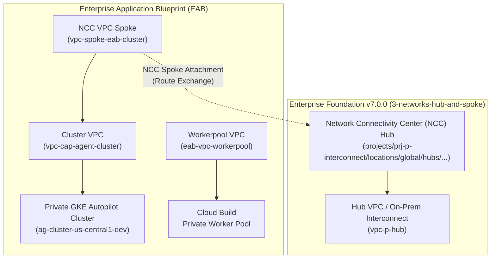

<!--
Copyright 2026 Google LLC

Licensed under the Apache License, Version 2.0 (the "License");
you may not use this file except in compliance with the License.
You may obtain a copy of the License at

     http://www.apache.org/licenses/LICENSE-2.0

Unless required by applicable law or agreed to in writing, software
distributed under the License is distributed on an "AS IS" BASIS,
WITHOUT WARRANTIES OR CONDITIONS OF ANY KIND, either express or implied.
See the License for the specific language governing permissions and
limitations under the License.
-->

# Deploying Enterprise Application Blueprint on top of Terraform Example Foundation (v7.0.0+ / v8.0)

These instructions explain how to deploy the [Enterprise Application Blueprint](https://github.com/GoogleCloudPlatform/terraform-google-enterprise-application) on top of the [Terraform Example Foundation](https://cloud.google.com/architecture/security-foundations/using-example-terraform) version [v7.0.0](https://github.com/terraform-google-modules/terraform-example-foundation/tree/v7.0.0) or later (including future v8.0).

The deployment of the Blueprint uses the `production` environment of Business Unit 1 of an existing Terraform Example Foundation and deploys the consolidated standalone infrastructure harness (`examples/agent/standalone-single-project`), which provisions:

- A standalone infrastructure harness combining network, cluster, fleet, and secure CI/CD resources in a single step (without requiring separate multi-stage `4-appfactory` and `5-appinfra` pipelines),
- A private Google Kubernetes Engine (GKE) Autopilot cluster registered with GKE Fleet, Anthos Service Mesh (ASM), Policy Controller, and Gateway API,
- Dedicated **Network Connectivity Center (NCC) Spokes** connecting the cluster and worker pool VPCs to the Foundation's centralized enterprise Hub network (**preferred and recommended architecture**),
- A dedicated Cloud Build Private Worker Pool connected to an isolated VPC with Google Cloud NAT and internal proxy routing for secure external dependency downloads (fully compliant with `constraints/compute.vmExternalIpAccess`),
- Artifact Registry repositories with Binary Authorization attestations and Cloud KMS CMEK encryption,
- Cloud Deploy delivery pipelines and Cloud Source Repositories (CSR) for CI/CD automation,
- The example GenAI / LLM Agent application workload (`examples/agent`).

The following Foundation infrastructure will be created or reused:

- The restricted VPC Service Controls (VPC-SC) perimeter and Hub-and-Spoke network created in Foundation steps `1-org`, `2-environments`, and `3-networks-hub-and-spoke` (or `3-networks-dual-svpc`).
- The **Network Connectivity Center (NCC) Hub** (`projects/<INTERCONNECT_PROJECT_ID>/locations/global/hubs/ncc-hub-...`) hosted in the centralized Interconnect / Hub project.
- The Business Unit 1 service project (`prj-p-bu1-sample-eab-xxxx`) created in Foundation step `4-projects`.
- All organization policies, IAM service account role bindings, APIs, and VPC-SC perimeter ingress/egress rules are **100% managed declaratively by the Foundation steps**. **No manual `gcloud` commands are required.**

---

## Networking Architectural Preference: Network Connectivity Center (NCC)

In enterprise deployments on top of **Foundation v7.0.0**, **Network Connectivity Center (NCC)** is the **preferred and standard networking topology** for connecting EAB VPCs, GKE clusters, and Cloud Build Private Worker Pools to the organization's enterprise network.



### Key Advantages of NCC over Legacy VPC Peering:
1. **No Transitive Peering Limitations**: NCC enables multi-VPC spoke routing without hitting the non-transitive boundary limitations of classic VPC Network Peering.
2. **Centralized Hub Governance**: Route exchange across business units, on-premises interconnects, and third-party SaaS is centrally managed and audited at the NCC Hub.
3. **Granular Route Filtering**: Precise control over exported and imported CIDR ranges via `spoke_exclude_export_ranges` and `spoke_include_export_ranges`.
4. **Seamless Hybrid & Multi-Cloud Connectivity**: Direct route propagation from Cloud Interconnect / Cloud VPN into EAB workloads.

---

## Prerequisites

### Code
- [terraform-example-foundation](https://github.com/terraform-google-modules/terraform-example-foundation/tree/v7.0.0) version `v7.0.0` deployed through at least step `4-projects`.
- You must have the **Service Account User** (`roles/iam.serviceAccountUser`) role on the [Terraform Service Accounts](https://github.com/terraform-google-modules/terraform-example-foundation/blob/master/docs/GLOSSARY.md#terraform-service-account) created in the foundation [Seed Project](https://github.com/terraform-google-modules/terraform-example-foundation/blob/master/docs/GLOSSARY.md#seed-project):
  - `sa-terraform-bootstrap@<SEED_PROJECT_ID>.iam.gserviceaccount.com`
  - `sa-terraform-env@<SEED_PROJECT_ID>.iam.gserviceaccount.com`
  - `sa-terraform-net@<SEED_PROJECT_ID>.iam.gserviceaccount.com`
  - `sa-terraform-proj@<SEED_PROJECT_ID>.iam.gserviceaccount.com`

> [!TIP]
> You can deploy the Terraform Example Foundation stages automatically using the built-in Go helper:
> ```bash
> cd terraform-example-foundation/helpers/foundation-deployer
> go run main.go -tfvars_file=global.tfvars -disable_prompt
> ```
> To deploy only the `production` environment, set `production_only_deploy = true` in `global.tfvars`.

### Software
Install the following local dependencies:

- [Google Cloud SDK](https://cloud.google.com/sdk/install) version 487.0.0 or later.
- [Terraform](https://www.terraform.io/downloads.html) version 1.6 or later.
- [Git](https://git-scm.com/) version 2.28 or later.
- [jq](https://stedolan.github.io/jq/) version 1.6 or later.

### Cloud SDK Configuration
Ensure Application Default Credentials (ADC) are configured:

```bash
gcloud auth login
gcloud auth application-default login
```

---

## Directory Layout and Terraform Initialization

For these instructions, we assume:

- Every Foundation repository is on the `production` branch and `terraform init` has been executed in each directory.
- The following folder layout exists in your local environment:

```text
gcp-bootstrap/
gcp-org/
gcp-environments/
gcp-networks/
gcp-projects/
terraform-google-enterprise-application/
```

If you do not have this layout, clone or check out the source repositories for the Foundation steps and the Enterprise Application Blueprint into the same parent workspace directory.

---

## Step 1: `4-projects` — Create Dedicated EAB Service Project and Enable Workload APIs

All Google Cloud APIs and Service Account IAM roles must be enabled declaratively by the Foundation during Stage `4-projects`.

Instead of modifying existing example files (`example_shared_vpc_project.tf` or `example_ncc_project.tf`), create a new dedicated project definition file in `gcp-projects/modules/base_env/`.

### 1.1. Create `gcp-projects/modules/base_env/eab_project.tf`

Create `gcp-projects/modules/base_env/eab_project.tf` with the `module "eab_project"` resource, configuring `enable_cloudbuild_deploy = local.enable_cloudbuild_deploy`, `app_infra_pipeline_service_accounts = local.app_infra_pipeline_service_accounts`, the required `activate_apis`, and `sa_roles` granting permissions to the Cloud Build workspace service account:

```hcl
/**
 * Copyright 2026 Google LLC
 *
 * Licensed under the Apache License, Version 2.0 (the "License");
 * you may not use this file except in compliance with the License.
 * You may obtain a copy of the License at
 *
 *      http://www.apache.org/licenses/LICENSE-2.0
 *
 * Unless required by applicable law or agreed to in writing, software
 * distributed under the License is distributed on an "AS IS" BASIS,
 * WITHOUT WARRANTIES OR CONDITIONS OF ANY KIND, either express or implied.
 * See the License for the specific language governing permissions and
 * limitations under the License.
 */

module "eab_project" {
  source = "../single_project"

  org_id                   = local.org_id
  billing_account          = local.billing_account
  folder_id                = google_folder.env_business_unit.name
  environment              = var.env
  project_budget           = var.project_budget
  project_prefix           = local.project_prefix
  universe_prefix          = local.universe_prefix
  billing_budget_available = local.available_universe_services.billing_budget

  project_deletion_policy = var.project_deletion_policy

  enable_cloudbuild_deploy            = local.enable_cloudbuild_deploy
  app_infra_pipeline_service_accounts = local.app_infra_pipeline_service_accounts

  sa_roles = {
    "${var.business_code}-example-app" = [
      "roles/compute.instanceAdmin.v1",
      "roles/compute.networkAdmin",
      "roles/compute.securityAdmin",
      "roles/container.admin",
      "roles/gkehub.admin",
      "roles/iam.serviceAccountUser",
      "roles/iam.serviceAccountAdmin",
      "roles/iam.securityAdmin",
      "roles/resourcemanager.projectIamAdmin",
      "roles/clouddeploy.admin",
      "roles/cloudbuild.builds.editor",
      "roles/cloudbuild.workerPoolOwner",
      "roles/cloudbuild.workerPoolUser",
      "roles/artifactregistry.admin",
      "roles/binaryauthorization.attestorsAdmin",
      "roles/source.admin",
      "roles/containeranalysis.notes.editor",
      "roles/secretmanager.admin",
      "roles/cloudkms.admin",
      "roles/serviceusage.serviceUsageAdmin",
      "roles/networkconnectivity.admin",
      "roles/storage.admin",
      "roles/viewer",
    ]
  }

  activate_apis = [
    "compute.googleapis.com",
    "container.googleapis.com",
    "gkehub.googleapis.com",
    "anthos.googleapis.com",
    "meshconfig.googleapis.com",
    "multiclusteringress.googleapis.com",
    "multiclusterservicediscovery.googleapis.com",
    "trafficdirector.googleapis.com",
    "networkconnectivity.googleapis.com",
    "clouddeploy.googleapis.com",
    "cloudbuild.googleapis.com",
    "artifactregistry.googleapis.com",
    "sourcerepo.googleapis.com",
    "binaryauthorization.googleapis.com",
    "containeranalysis.googleapis.com",
    "connectgateway.googleapis.com",
    "iam.googleapis.com",
    "iamcredentials.googleapis.com",
    "logging.googleapis.com",
    "monitoring.googleapis.com",
    "cloudtrace.googleapis.com",
    "cloudresourcemanager.googleapis.com",
    "serviceusage.googleapis.com",
    "secretmanager.googleapis.com",
    "cloudkms.googleapis.com",
    "servicenetworking.googleapis.com",
    "networkmanagement.googleapis.com"
  ]

  vpc_service_control_attach_enabled = local.enforce_vpcsc ? "true" : "false"
  vpc_service_control_attach_dry_run = !local.enforce_vpcsc ? "true" : "false"
  vpc_service_control_perimeter_name = "accessPolicies/${local.access_context_manager_policy_id}/servicePerimeters/${local.perimeter_name}"
  vpc_service_control_sleep_duration = "60s"

  # Metadata
  project_suffix    = "sample-eab"
  application_name  = "${var.business_code}-sample-application"
  billing_code      = "1234"
  primary_contact   = "example@example.com"
  secondary_contact = "example2@example.com"
  business_code     = var.business_code
}
```

### 1.2. Export EAB Project Outputs

Add the outputs to `gcp-projects/modules/base_env/outputs.tf`:

```hcl
output "eab_project" {
  description = "EAB service project ID."
  value       = module.eab_project.project_id
}

output "eab_project_number" {
  description = "EAB service project number."
  value       = module.eab_project.project_number
}
```

And in `gcp-projects/business_unit_1/production/outputs.tf` (and `development/outputs.tf`, `nonproduction/outputs.tf`):

```hcl
output "eab_project" {
  description = "EAB service project ID."
  value       = module.env.eab_project
}

output "eab_project_number" {
  description = "EAB service project number."
  value       = module.env.eab_project_number
}
```

### 1.3. Create Cloud KMS Key for Binary Authorization Attestation

If you want the EAB deployment pipeline to automatically sign container images during Cloud Build and enforce Binary Authorization on the GKE cluster, create an asymmetric signing KMS key in the Foundation `4-projects` stage.

Binary Authorization and Cloud Build require a Cloud KMS key configured with:
- **Purpose**: `ASYMMETRIC_SIGN`
- **Key Algorithm**: `RSA_SIGN_PKCS1_4096_SHA512`
- **Key Rotation Period**: `null` (asymmetric keys do not support automatic rotation)
- **IAM**: `roles/cloudkms.signerVerifier` granted to the application CI/CD Service Account.

Add the following to `gcp-projects/modules/base_env/example_attestation_cmek.tf`:

```hcl
module "kms_attestation" {
  source  = "terraform-google-modules/kms/google"
  version = "~> 4.1"

  project_id          = local.kms_project_id # or module.eab_project.project_id
  keyring             = "kms-attestation-ring-${var.env}"
  location            = var.location_kms
  keys                = ["attestation-key"]
  purpose             = "ASYMMETRIC_SIGN"
  key_algorithm       = "RSA_SIGN_PKCS1_4096_SHA512"
  key_rotation_period = null
  prevent_destroy     = false

  # Grant signing and verification permissions to the application CI/CD pipeline service accounts
  set_decrypters_for = ["attestation-key"]
  decrypters = [
    for sa in local.app_infra_pipeline_service_accounts : "serviceAccount:${sa}"
  ]
}
```

Export the key in `gcp-projects/modules/base_env/outputs.tf`:

```hcl
output "attestation_kms_key" {
  description = "KMS Crypto Key ID for Binary Authorization Attestation."
  value       = module.kms_attestation.keys["attestation-key"]
}
```

And in `gcp-projects/business_unit_1/production/outputs.tf` (and `development/outputs.tf`, `nonproduction/outputs.tf`):

```hcl
output "attestation_kms_key" {
  description = "KMS Crypto Key ID for Binary Authorization Attestation."
  value       = module.env.attestation_kms_key
}
```

### 1.4. Commit and Apply `4-projects` (Shared Pipeline & Production Service Projects)

Apply the shared infrastructure pipeline first to provision the dedicated Cloud Source Repositories, Cloud Build triggers, and state buckets, followed by the service project:

#### Option A: Deploy via Foundation CI/CD Pipeline (Recommended)

1. **Trigger Plan**: Commit and push changes to the `plan` branch:
   ```bash
   cd gcp-projects
   git checkout -b plan || git checkout plan
   git add modules/base_env/eab_project.tf modules/base_env/outputs.tf outputs.tf
   git commit -m "feat: add dedicated eab service project with workload APIs and roles"
   git push origin plan
   ```

2. **Trigger Apply**: Merge or push the changes to the `production` branch to execute `terraform apply`:
   ```bash
   git checkout production
   git merge plan
   git push origin production
   ```

#### Option B: Direct Local Execution via Terraform CLI

```bash
# 1. Apply BU1 Shared Infrastructure Pipeline
cd gcp-projects/business_unit_1/shared
terraform init
terraform plan
terraform apply

# 2. Apply BU1 Production Service Project
cd ../production
terraform init
terraform plan
terraform apply
```

### 1.5. Retrieve EAB Service Project Number

Initialize Terraform in the production environment and retrieve the newly provisioned service project number to be used in Step 2 for VPC Service Controls:

```bash
terraform -chdir="gcp-projects/business_unit_1/production" init
export SERVICE_PROJECT_NUMBER=$(terraform -chdir="gcp-projects/business_unit_1/production" output -raw eab_project_number)

echo "EAB Service Project Number: ${SERVICE_PROJECT_NUMBER}"
```

---

## Step 2: `1-org` — Configure Workload VPC-SC Ingress & Egress Rules

All VPC Service Controls perimeter configurations are governed exclusively by the Foundation in `1-org`. The Enterprise Application Blueprint (EAB) does not declare or provision Access Context Manager resources (`google_access_context_manager_*`).

When VPC Service Controls are enforced in the Foundation perimeter (`enforce_vpcsc = true`), declare the required ingress and egress rules for Cloud Build Private Worker Pools and Cloud Deploy in `gcp-org/envs/shared/terraform.tfvars`, using the `SERVICE_PROJECT_NUMBER` obtained in Step 1.5.

### 2.1. Update `gcp-org/envs/shared/terraform.tfvars`

Add the `eab_private_workerpool_deployment` rule to `ingress_policies_map` (and `ingress_policies_dry_run_map`):

```hcl
ingress_policies_map = {
  "eab_private_workerpool_deployment" = {
    title = "EAB Private Worker Pool Deployment to Service Project"
    from = {
      identity_type = "ANY_IDENTITY"
      sources = {
        resources = [
          "projects/SERVICE_PROJECT_NUMBER"
        ]
      }
    }
    to = {
      resources = [
        "projects/SERVICE_PROJECT_NUMBER"
      ]
      operations = {
        "storage.googleapis.com" = {
          methods = ["*"]
        }
        "logging.googleapis.com" = {
          methods = ["*"]
        }
        "artifactregistry.googleapis.com" = {
          methods = ["*"]
        }
        "clouddeploy.googleapis.com" = {
          methods = ["*"]
        }
        "gkehub.googleapis.com" = {
          methods = ["*"]
        }
        "connectgateway.googleapis.com" = {
          methods = ["*"]
        }
        "binaryauthorization.googleapis.com" = {
          methods = ["*"]
        }
        "cloudkms.googleapis.com" = {
          methods = ["*"]
        }
        "containeranalysis.googleapis.com" = {
          methods = ["*"]
        }
        "iamcredentials.googleapis.com" = {
          methods = ["*"]
        }
      }
    }
  }
}
```

> [!NOTE]
> Replace `SERVICE_PROJECT_NUMBER` with the numeric ID of your target service project retrieved in Step 1.5 (e.g., `468623595471`).

### 2.2. Commit and Apply `1-org`

You can deploy the updated VPC Service Controls perimeter using your Foundation CI/CD pipeline (Git) or direct local execution:

#### Option A: Deploy via Foundation CI/CD Pipeline (Recommended)

1. **Trigger Plan**: Commit and push changes to the `plan` branch:
   ```bash
   cd gcp-org
   git checkout -b plan || git checkout plan
   git add envs/shared/terraform.tfvars
   git commit -m "feat: add EAB private worker pool ingress rule to perimeter"
   git push origin plan
   ```
   Review the Cloud Build plan execution in the Google Cloud Console under the bootstrap/seed project.

2. **Trigger Apply**: Merge or push the changes to the `production` environment branch to execute `terraform apply`:
   ```bash
   git checkout production
   git merge plan
   git push origin production
   ```

#### Option B: Direct Local Execution via Terraform CLI

```bash
cd gcp-org/envs/shared
terraform init
terraform plan
terraform apply
```

---

## Step 3: Deploy Enterprise Application Blueprint (EAB) with NCC

You can deploy the Enterprise Application Blueprint using one of two approaches:

- **Approach A: Automated CI/CD Deployment via Foundation Repositories (Recommended)**: Uses the dedicated Cloud Source Repositories and Cloud Build private worker pool created by Foundation Stage `4-projects/business_unit_1/shared`.
- **Approach B: Direct Local Deployment via Terraform CLI**: Executes `terraform apply` directly against the target service project.

---

### Approach A: Deploy via Foundation CI/CD Repositories (`4-projects`)

This approach leverages the infrastructure pipeline project (`prj-c-bu1-infra-pipeline-xxxx`) and Cloud Source Repository (`bu1-example-app`) provisioned during Foundation Stage `4-projects`.

#### A.1. Retrieve Pipeline & Infrastructure Information

Initialize Terraform in the respective Foundation directories and retrieve the pipeline, service project, and NCC Hub details:

```bash
# 1. Initialize and retrieve Foundation Pipeline Project ID
terraform -chdir="gcp-projects/business_unit_1/shared" init
export INFRA_PIPELINE_PROJECT_ID=$(terraform -chdir="gcp-projects/business_unit_1/shared" output -raw cloudbuild_project_id)

# 2. Initialize and retrieve Service Project ID
terraform -chdir="gcp-projects/business_unit_1/production" init
export SERVICE_PROJECT_ID=$(terraform -chdir="gcp-projects/business_unit_1/production" output -raw eab_project)

# 3. Initialize and retrieve NCC Hub URI from Foundation networks
terraform -chdir="gcp-networks/envs/production" init
export NCC_HUB_URI=$(terraform -chdir="gcp-networks/envs/production" output -raw ncc_hub_uri 2>/dev/null || terraform -chdir="gcp-networks/envs/production" output -raw hub_uri)

echo "Pipeline Project: ${INFRA_PIPELINE_PROJECT_ID}"
echo "Service Project:  ${SERVICE_PROJECT_ID}"
echo "NCC Hub URI:      ${NCC_HUB_URI}"
```

#### A.2. Initialize the Policy Library Repository (If not already initialized)

Clone the `gcp-policies` repository created in the shared pipeline project according to your Foundation VCS provider (CSR, GitHub, or GitLab):

```bash
# Option 1: Cloud Source Repositories (CSR)
gcloud source repos clone gcp-policies gcp-policies-app-infra --project=${INFRA_PIPELINE_PROJECT_ID}
cd gcp-policies-app-infra
git checkout -b main || git checkout main

# Option 2: GitHub (if Foundation is configured with GitHub)
# git clone git@github.com:<GITHUB_ORG>/gcp-policies.git gcp-policies-app-infra
# cd gcp-policies-app-infra
# git checkout -b main || git checkout main

# Option 3: GitLab (if Foundation is configured with GitLab)
# git clone git@gitlab.com:<GITLAB_GROUP>/gcp-policies.git gcp-policies-app-infra
# cd gcp-policies-app-infra
# git checkout -b main || git checkout main

# Copy policies from the foundation repository
cp -RT ../gcp-policies/ . || cp -RT ../terraform-example-foundation/policy-library/ .

git add .
git commit -m "feat: initialize policy library for application infrastructure"
git push --set-upstream origin main
cd ..
```

#### A.3. Clone and Copy EAB as a Module into the Repository

Clone the application infrastructure repository (`bu1-example-app`) created by Foundation Stage `4-projects` according to your VCS provider, and copy the Enterprise Application Blueprint as a dedicated module under `modules/eab-capital-agent/`:

```bash
# Option 1: Cloud Source Repositories (CSR)
gcloud source repos clone bu1-example-app --project=${INFRA_PIPELINE_PROJECT_ID}
cd bu1-example-app

# Option 2: GitHub (if Foundation is configured with GitHub)
# git clone git@github.com:<GITHUB_ORG>/bu1-example-app.git
# cd bu1-example-app

# Option 3: GitLab (if Foundation is configured with GitLab)
# git clone git@gitlab.com:<GITLAB_GROUP>/bu1-example-app.git
# cd bu1-example-app

# Switch to the plan branch
git checkout -b plan || git checkout plan

# Copy EAB into the repository's modules directory
mkdir -p modules/eab-capital-agent
cp -RT ../terraform-google-enterprise-application/examples/agent/standalone-single-project/ modules/eab-capital-agent/
```

#### A.4. Instantiate EAB Module in `business_unit_1/production/main.tf`

Add the `module "capital_agent"` block to `business_unit_1/production/main.tf`. The module automatically consumes project IDs and NCC Hub details from the Foundation's existing remote state (`data.terraform_remote_state.projects_env`):

```hcl
module "capital_agent" {
  source = "../../modules/eab-capital-agent"

  project_id = data.terraform_remote_state.projects_env.outputs.eab_project
  region     = coalesce(var.instance_region, local.default_region)

  # VPC-SC Governance: Managed exclusively by Foundation
  service_perimeter_name = null
  service_perimeter_mode = null

  # Network Connectivity Center (NCC) Configuration
  ncc_config = {
    enable_ncc                  = true
    hub_uri                     = data.terraform_remote_state.projects_env.outputs.ncc_hub_uri
    spoke_group                 = data.terraform_remote_state.projects_env.outputs.ncc_spoke_group
    spoke_name                  = "vpc-spoke-eab-cluster"
    spoke_description           = "NCC VPC Spoke for EAB GKE Cluster"
    spoke_exclude_export_ranges = []
    spoke_include_export_ranges = []
  }

  environment = local.environment

  # Binary Authorization Attestation KMS Key (created in Foundation Step 1.3)
  attestation_kms_key = try(data.terraform_remote_state.projects_env.outputs.attestation_kms_key, null)

  teams = {
    "capital-agent" = "corp_it_admin@example.com"
  }

  create_nat = true

  # Option 1: Cloud Source Repositories (CSR)
  cloudbuildv2_repository_config = {
    repo_type = "CSR"
    repositories = {
      "eab-agent-capital-agent" = {
        repository_name = "eab-agent-capital-agent"
        repository_url  = ""
      }
    }
  }

  # Option 2: GitHub (GITHUBv2)
  # cloudbuildv2_repository_config = {
  #   repo_type               = "GITHUBv2"
  #   github_secret_id        = "projects/${data.terraform_remote_state.projects_env.outputs.eab_project_number}/secrets/github-pat/versions/latest"
  #   github_app_id_secret_id = "projects/${data.terraform_remote_state.projects_env.outputs.eab_project_number}/secrets/github-app-id/versions/latest"
  #   repositories = {
  #     "eab-agent-capital-agent" = {
  #       repository_name = "eab-agent-capital-agent"
  #       repository_url  = "https://github.com/<GITHUB_ORG>/eab-agent-capital-agent.git"
  #     }
  #   }
  # }

  # Option 3: GitLab (GITLABv2)
  # cloudbuildv2_repository_config = {
  #   repo_type                                   = "GITLABv2"
  #   gitlab_read_authorizer_credential_secret_id = "projects/${data.terraform_remote_state.projects_env.outputs.eab_project_number}/secrets/gitlab-read-token/versions/latest"
  #   gitlab_authorizer_credential_secret_id      = "projects/${data.terraform_remote_state.projects_env.outputs.eab_project_number}/secrets/gitlab-authorizer-token/versions/latest"
  #   gitlab_webhook_secret_id                    = "projects/${data.terraform_remote_state.projects_env.outputs.eab_project_number}/secrets/gitlab-webhook/versions/latest"
  #   repositories = {
  #     "eab-agent-capital-agent" = {
  #       repository_name = "eab-agent-capital-agent"
  #       repository_url  = "https://gitlab.com/<GITLAB_GROUP>/eab-agent-capital-agent.git"
  #     }
  #   }
  # }
}
```

#### A.5. Export EAB Module Outputs (Optional)

Add the output to `business_unit_1/production/outputs.tf`:

```hcl
output "capital_agent" {
  description = "EAB capital agent infrastructure outputs."
  value       = module.capital_agent
}
```

#### A.6. Trigger Automated Plan and Apply via Git

1. **Trigger Terraform Plan**: Push to the `plan` branch to trigger an automated `terraform plan` in the Cloud Build Private Worker Pool:

   ```bash
   git add .
   git commit -m "feat: add EAB capital-agent module to production environment"
   git push --set-upstream origin plan
   ```

   Review the plan build execution in the Google Cloud Console under the `${INFRA_PIPELINE_PROJECT_ID}` project.

2. **Trigger Terraform Apply**: Merge or push the changes to the `production` environment branch to execute `terraform apply`:

   ```bash
   git checkout production
   git merge plan
   git push origin production
   ```

   Cloud Build runs the apply step within the private worker pool, provisioning the GKE Autopilot cluster, NCC spoke, Fleet membership, and secure CI/CD delivery pipelines.

---

### Approach B: Direct Local Deployment via Terraform CLI

Use this approach for rapid testing, sandboxing, or developer evaluation where direct Terraform execution permissions are available.

#### B.1. Navigate to the Blueprint Directory

```bash
cd terraform-google-enterprise-application/examples/agent/standalone-single-project
```

#### B.2. Retrieve Foundation Outputs (Project ID & NCC Hub URI)

```bash
# 1. Initialize and retrieve Service Project ID
terraform -chdir="../../../../gcp-projects/business_unit_1/production" init
export SERVICE_PROJECT_ID=$(terraform -chdir="../../../../gcp-projects/business_unit_1/production" output -raw eab_project)

# 2. Initialize and retrieve NCC Hub URI from Foundation 3-networks-hub-and-spoke
terraform -chdir="../../../../gcp-networks/envs/production" init
export NCC_HUB_URI=$(terraform -chdir="../../../../gcp-networks/envs/production" output -raw ncc_hub_uri 2>/dev/null || terraform -chdir="../../../../gcp-networks/envs/production" output -raw hub_uri)

export DEFAULT_REGION="us-central1"

echo "Deploying EAB to Service Project: ${SERVICE_PROJECT_ID}"
echo "Connecting to NCC Hub: ${NCC_HUB_URI}"
```

#### B.3. Configure `terraform.tfvars` with `ncc_config`

Create or update `terraform.tfvars`:

```hcl
project_id  = "SERVICE_PROJECT_ID"
region      = "us-central1"
environment = "production"

# Optional: Binary Authorization Attestation KMS Key (created in Foundation Step 1.3)
# attestation_kms_key = "projects/KMS_PROJECT_ID/locations/us-central1/keyRings/kms-attestation-ring-production/cryptoKeys/attestation-key"

# VPC-SC Governance: Managed exclusively by Foundation
service_perimeter_name = null
service_perimeter_mode = null

# Network Connectivity Center (NCC) Configuration (Preferred)
ncc_config = {
  enable_ncc                  = true
  hub_uri                     = "projects/INTERCONNECT_PROJECT_ID/locations/global/hubs/HUB_NAME"
  spoke_group                 = "default"
  spoke_name                  = "vpc-spoke-eab-cluster"
  spoke_description           = "NCC VPC Spoke for EAB GKE Cluster"
  spoke_exclude_export_ranges = []
  spoke_include_export_ranges = []
}

teams = {
  "capital-agent" = "corp_it_admin@example.com"
}

create_nat = true

cloudbuildv2_repository_config = {
  repo_type = "CSR"
  repositories = {
    "eab-agent-capital-agent" = {
      repository_name = "eab-agent-capital-agent"
      repository_url  = ""
    }
  }
}
```

> [!IMPORTANT]
> - Setting `ncc_config.enable_ncc = true` and specifying `hub_uri` automatically provisions an NCC VPC Spoke attaching the EAB cluster VPC to the Foundation's central NCC Hub.
> - Setting `service_perimeter_name = null` instructs the EAB module to skip Access Context Manager provisioning and rely entirely on the perimeter established in Foundation Stage `1-org`.

#### B.4. Initialize and Apply EAB

```bash
terraform init
terraform plan -out=tfplan
terraform apply tfplan
```

Upon successful application, Terraform displays the following outputs:

```text
Apply complete! Resources: 39 added, 0 changed, 0 destroyed.

Outputs:
acronyms = {
  "capital-agent" = "ag"
}
cluster_project_id = "prj-p-bu1-sample-eab-xxxx"
cluster_type = "AUTOPILOT"
env = "development"
fleet_project_id = "prj-p-bu1-sample-eab-xxxx"
network_project_id = "prj-p-bu1-sample-eab-xxxx"
service_repository_name = {
  "eab-agent-capital-agent" = "eab-agent-capital-agent"
}
service_repository_project_id = {
  "eab-agent-capital-agent" = "prj-p-bu1-sample-eab-xxxx"
}
```

---

## Step 4: Application Source & Delivery (`6-appsource`)

Deploy the application source code through the automated CI/CD pipeline.

### 4.1. Push Application Code to Source Repositories

Clone the application source repository provisioned by EAB according to your VCS provider:

```bash
# Option 1: Cloud Source Repositories (CSR)
gcloud source repos clone eab-agent-capital-agent --project=${SERVICE_PROJECT_ID}
cd eab-agent-capital-agent

# Option 2: GitHub (if using GITHUBv2)
# git clone git@github.com:<GITHUB_ORG>/eab-agent-capital-agent.git
# cd eab-agent-capital-agent

# Option 3: GitLab (if using GITLABv2)
# git clone git@gitlab.com:<GITLAB_GROUP>/eab-agent-capital-agent.git
# cd eab-agent-capital-agent

# Copy application source from the blueprint example
cp -r ../../6-appsource/* .

# Commit and push
git config user.email "terraform-agent@example.com"
git config user.name "Terraform Automation"
git add .
git commit -m "feat: initial commit for capital-agent service"
git push origin main
```

### 4.2. Monitor Cloud Build and Cloud Deploy

The deployment workflow runs in two progressive stages:
1. **Cloud Build**: The commit triggers a build in the Cloud Build Private Worker Pool, compiling container images, executing tests, signing Binary Authorization attestations, and finally creating a Cloud Deploy release.
2. **Cloud Deploy**: Once the container image build completes and Cloud Build creates the release, Cloud Deploy initiates a rollout to deploy the manifests to the GKE Autopilot cluster.

#### Step 1: Monitor Cloud Build Execution

Track the active build until completion:

```bash
# List recent Cloud Build executions
gcloud builds list \
  --project=${SERVICE_PROJECT_ID} \
  --region=us-central1 \
  --limit=5

# Stream the build logs in real-time (replace with your BUILD_ID)
BUILD_ID=$(gcloud builds list \
  --project=${SERVICE_PROJECT_ID} \
  --region=us-central1 \
  --format="value(id)" \
  --limit=1)

gcloud builds log ${BUILD_ID} \
  --project=${SERVICE_PROJECT_ID} \
  --region=us-central1 \
  --stream
```

#### Step 2: Monitor Cloud Deploy Release and Rollout

Once the Cloud Build execution completes with `SUCCESS`, Cloud Build creates the Cloud Deploy release and initiates the rollout:

```bash
# Identify the latest release created by Cloud Build
LATEST_RELEASE=$(gcloud deploy releases list \
  --delivery-pipeline=capital-agent \
  --project=${SERVICE_PROJECT_ID} \
  --region=us-central1 \
  --format="value(name)" \
  --limit=1)

echo "Latest release: ${LATEST_RELEASE}"

# Monitor the rollout status for this release
gcloud deploy rollouts list \
  --delivery-pipeline=capital-agent \
  --release=${LATEST_RELEASE} \
  --project=${SERVICE_PROJECT_ID} \
  --region=us-central1
```

### 4.3. Verify Workload Health

Once the rollout status reaches `SUCCEEDED`, connect to the cluster via Connect Gateway and verify the application resources and endpoints:

```bash
# Obtain kubectl credentials via Connect Gateway
gcloud container fleet memberships get-credentials ag-cluster-us-central1-production \
  --project=${SERVICE_PROJECT_ID}

# Verify pods, gateway, and HTTPRoute
kubectl get pods,gateway,httproute -n capital-agent-production

# Obtain the Gateway IP address
GATEWAY_IP=$(kubectl get gateway capital-agent-gw -n capital-agent-production -o jsonpath='{.status.addresses[0].value}')

# Test Health Endpoint
curl "http://${GATEWAY_IP}/health"
# Expected response: ok (HTTP 200)

# Test Readiness Endpoint
curl "http://${GATEWAY_IP}/ready"
# Expected response: ready (HTTP 200)
```

---

## Teardown and Cleanup

To clean up resources provisioned during this guide:

### 1. Destroy Enterprise Application Blueprint

```bash
cd terraform-google-enterprise-application/examples/agent/standalone-single-project
terraform destroy -auto-approve
```

### 2. Destroy Foundation Projects & Networking (Optional)

If tearing down the entire test environment, follow the Foundation teardown sequence in reverse:

```bash
# 1. 4-projects
cd gcp-projects/business_unit_1/production && terraform destroy -auto-approve

# 2. 3-networks (or 3-networks-hub-and-spoke)
cd gcp-networks/envs/production && terraform destroy -auto-approve

# 3. 2-environments
cd gcp-environments/envs/production && terraform destroy -auto-approve

# 4. 1-org
cd gcp-org/envs/shared && terraform destroy -auto-approve

# 5. 0-bootstrap
cd gcp-bootstrap/envs/shared && terraform destroy -auto-approve
```
