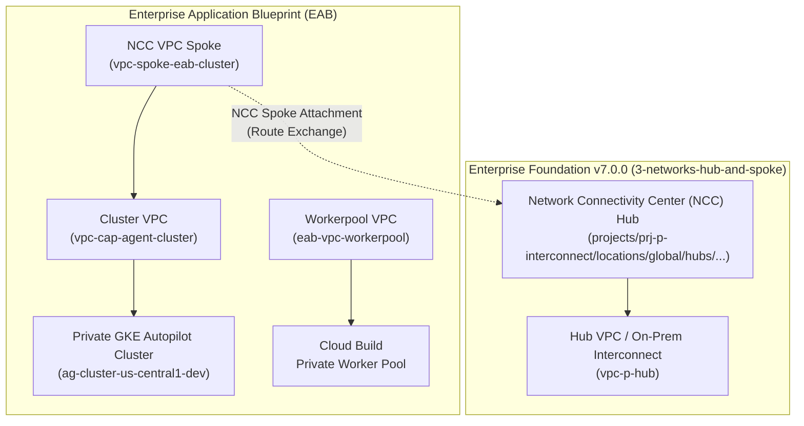

<!--
Copyright 2026 Google LLC

Licensed under the Apache License, Version 2.0 (the "License");
you may not use this file except in compliance with the License.
You may obtain a copy of the License at

     http://www.apache.org/licenses/LICENSE-2.0

Unless required by applicable law or agreed to in writing, software
distributed under the License is distributed on an "AS IS" BASIS,
WITHOUT WARRANTIES OR CONDITIONS OF ANY KIND, either express or implied.
See the License for the specific language governing permissions and
limitations under the License.
-->

# Deploying Enterprise Application Blueprint on top of Terraform Example Foundation v7.0.0

These instructions explain how to deploy the [Enterprise Application Blueprint](https://github.com/GoogleCloudPlatform/terraform-google-enterprise-application) on top of the [Terraform Example Foundation](https://cloud.google.com/architecture/security-foundations/using-example-terraform) version [v7.0.0](https://github.com/terraform-google-modules/terraform-example-foundation/tree/v7.0.0).

The deployment of the Blueprint uses the `production` environment of Business Unit 1 of an existing Terraform Example Foundation and deploys the consolidated standalone infrastructure harness (`examples/agent/standalone-single-project`), which provisions:

- A standalone infrastructure harness combining network, cluster, fleet, and secure CI/CD resources in a single step (without requiring separate multi-stage `4-appfactory` and `5-appinfra` pipelines),
- A private Google Kubernetes Engine (GKE) Autopilot cluster registered with GKE Fleet, Anthos Service Mesh (ASM), Policy Controller, and Gateway API,
- Dedicated **Network Connectivity Center (NCC) Spokes** connecting the cluster and worker pool VPCs to the Foundation's centralized enterprise Hub network (**preferred and recommended architecture**),
- A dedicated Cloud Build Private Worker Pool connected to an isolated VPC with Google Cloud NAT and internal proxy routing for secure external dependency downloads (fully compliant with `constraints/compute.vmExternalIpAccess`),
- Artifact Registry repositories with Binary Authorization attestations and Cloud KMS CMEK encryption,
- Cloud Deploy delivery pipelines and Cloud Source Repositories (CSR) for CI/CD automation,
- The example GenAI / LLM Agent application workload (`examples/agent`).

The following Foundation infrastructure will be created or reused:

- The restricted VPC Service Controls (VPC-SC) perimeter and Hub-and-Spoke network created in Foundation steps `1-org`, `2-environments`, and `3-networks-hub-and-spoke` (or `3-networks-dual-svpc`).
- The **Network Connectivity Center (NCC) Hub** (`projects/<INTERCONNECT_PROJECT_ID>/locations/global/hubs/ncc-hub-...`) hosted in the centralized Interconnect / Hub project.
- The Business Unit 1 service project (`prj-p-bu1-sample-svpc-xxxx`) created in Foundation step `4-projects`.
- All organization policies, IAM service account role bindings, APIs, and VPC-SC perimeter ingress/egress rules are **100% managed declaratively by the Foundation steps**. **No manual `gcloud` commands are required.**

---

## Networking Architectural Preference: Network Connectivity Center (NCC)

In enterprise deployments on top of **Foundation v7.0.0**, **Network Connectivity Center (NCC)** is the **preferred and standard networking topology** for connecting EAB VPCs, GKE clusters, and Cloud Build Private Worker Pools to the organization's enterprise network.



### Key Advantages of NCC over Legacy VPC Peering:
1. **No Transitive Peering Limitations**: NCC enables multi-VPC spoke routing without hitting the non-transitive boundary limitations of classic VPC Network Peering.
2. **Centralized Hub Governance**: Route exchange across business units, on-premises interconnects, and third-party SaaS is centrally managed and audited at the NCC Hub.
3. **Granular Route Filtering**: Precise control over exported and imported CIDR ranges via `spoke_exclude_export_ranges` and `spoke_include_export_ranges`.
4. **Seamless Hybrid & Multi-Cloud Connectivity**: Direct route propagation from Cloud Interconnect / Cloud VPN into EAB workloads.

---

## Prerequisites

### Code
- [terraform-example-foundation](https://github.com/terraform-google-modules/terraform-example-foundation/tree/v7.0.0) version `v7.0.0` deployed through at least step `4-projects`.
- You must have the **Service Account User** (`roles/iam.serviceAccountUser`) role on the [Terraform Service Accounts](https://github.com/terraform-google-modules/terraform-example-foundation/blob/master/docs/GLOSSARY.md#terraform-service-account) created in the foundation [Seed Project](https://github.com/terraform-google-modules/terraform-example-foundation/blob/master/docs/GLOSSARY.md#seed-project):
  - `sa-terraform-bootstrap@<SEED_PROJECT_ID>.iam.gserviceaccount.com`
  - `sa-terraform-env@<SEED_PROJECT_ID>.iam.gserviceaccount.com`
  - `sa-terraform-net@<SEED_PROJECT_ID>.iam.gserviceaccount.com`
  - `sa-terraform-proj@<SEED_PROJECT_ID>.iam.gserviceaccount.com`

> [!TIP]
> You can deploy the Terraform Example Foundation stages automatically using the built-in Go helper:
> ```bash
> cd terraform-example-foundation/helpers/foundation-deployer
> go run main.go -tfvars_file=global.tfvars -disable_prompt
> ```
> To deploy only the `production` environment, set `production_only_deploy = true` in `global.tfvars`.

### Software
Install the following local dependencies:

- [Google Cloud SDK](https://cloud.google.com/sdk/install) version 480.0.0 or later.
- [Terraform](https://www.terraform.io/downloads.html) version 1.5.7 or later.
- [Git](https://git-scm.com/) version 2.28 or later.
- [jq](https://stedolan.github.io/jq/) version 1.6 or later.

### Cloud SDK Configuration
Ensure Application Default Credentials (ADC) are configured:

```bash
gcloud auth login
gcloud auth application-default login
```

---

## Directory Layout and Terraform Initialization

For these instructions, we assume:

- Every Foundation repository is on the `production` branch and `terraform init` has been executed in each directory.
- The following folder layout exists in your local environment:

```text
gcp-bootstrap/
gcp-org/
gcp-environments/
gcp-networks/
gcp-projects/
terraform-google-enterprise-application/
```

If you do not have this layout, clone or check out the source repositories for the Foundation steps and the Enterprise Application Blueprint into the same parent workspace directory.

---

## Step 1: `1-org` — Configure Workload VPC-SC Ingress & Egress Rules

All VPC Service Controls perimeter configurations are governed exclusively by the Foundation in `1-org`. The Enterprise Application Blueprint (EAB) does not declare or provision Access Context Manager resources (`google_access_context_manager_*`).

When VPC Service Controls are enforced in the Foundation perimeter (`enforce_vpcsc = true`), declare the required ingress and egress rules for Cloud Build Private Worker Pools and Cloud Deploy in `gcp-org/envs/shared/terraform.tfvars`.

### 1.1. Update `gcp-org/envs/shared/terraform.tfvars`

Add the `eab_private_workerpool_deployment` rule to `ingress_policies_map` (and `ingress_policies_dry_run_map`):

```hcl
ingress_policies_map = {
  "eab_private_workerpool_deployment" = {
    title = "EAB Private Worker Pool Deployment to Service Project"
    from = {
      identity_type = "ANY_IDENTITY"
      sources = [
        {
          resource = "projects/SERVICE_PROJECT_NUMBER"
        }
      ]
    }
    to = {
      resources = [
        "projects/SERVICE_PROJECT_NUMBER"
      ]
      operations = [
        {
          service_name = "storage.googleapis.com"
          method_selectors = [
            { method = "*" }
          ]
        },
        {
          service_name = "logging.googleapis.com"
          method_selectors = [
            { method = "*" }
          ]
        },
        {
          service_name = "artifactregistry.googleapis.com"
          method_selectors = [
            { method = "*" }
          ]
        },
        {
          service_name = "clouddeploy.googleapis.com"
          method_selectors = [
            { method = "*" }
          ]
        },
        {
          service_name = "gkehub.googleapis.com"
          method_selectors = [
            { method = "*" }
          ]
        },
        {
          service_name = "connectgateway.googleapis.com"
          method_selectors = [
            { method = "*" }
          ]
        },
        {
          service_name = "binaryauthorization.googleapis.com"
          method_selectors = [
            { method = "*" }
          ]
        },
        {
          service_name = "cloudkms.googleapis.com"
          method_selectors = [
            { method = "*" }
          ]
        },
        {
          service_name = "containeranalysis.googleapis.com"
          method_selectors = [
            { method = "*" }
          ]
        },
        {
          service_name = "iamcredentials.googleapis.com"
          method_selectors = [
            { method = "*" }
          ]
        }
      ]
    }
  }
}
```

> [!NOTE]
> Replace `SERVICE_PROJECT_NUMBER` with the numeric ID of your target service project (e.g., `prj-p-bu1-sample-svpc-xxxx`), obtainable from `terraform -chdir="gcp-projects/business_unit_1/production" output base_shared_vpc_project_number`.

### 1.2. Commit and Apply `1-org`

```bash
cd gcp-org/envs/shared
terraform init
terraform plan
terraform apply
```

---

## Step 2: `4-projects` — Enable Workload APIs and Service Account Roles

All Google Cloud APIs and Service Account IAM roles must be enabled declaratively by the Foundation during Stage `4-projects`.

### 2.1. Update `gcp-projects/modules/base_env/example_shared_vpc_project.tf`

Ensure the list of `activate_apis` in the service project module includes all APIs required by the Blueprint and Network Connectivity Center (NCC), and configure `sa_roles` to grant the Cloud Build workspace service account the required permissions:

```hcl
  sa_roles = {
    "${var.business_code}-example-app" = [
      "roles/compute.instanceAdmin.v1",
      "roles/compute.networkAdmin",
      "roles/compute.securityAdmin",
      "roles/container.admin",
      "roles/gkehub.admin",
      "roles/iam.serviceAccountUser",
      "roles/iam.serviceAccountAdmin",
      "roles/iam.securityAdmin",
      "roles/resourcemanager.projectIamAdmin",
      "roles/clouddeploy.admin",
      "roles/cloudbuild.builds.editor",
      "roles/cloudbuild.workerPoolOwner",
      "roles/cloudbuild.workerPoolUser",
      "roles/artifactregistry.admin",
      "roles/binaryauthorization.attestorsAdmin",
      "roles/source.admin",
      "roles/containeranalysis.notes.editor",
      "roles/secretmanager.admin",
      "roles/cloudkms.admin",
      "roles/serviceusage.serviceUsageAdmin",
      "roles/networkconnectivity.admin",
      "roles/storage.admin",
      "roles/viewer",
    ]
  }

  activate_apis = [
    "compute.googleapis.com",
    "container.googleapis.com",
    "gkehub.googleapis.com",
    "anthos.googleapis.com",
    "meshconfig.googleapis.com",
    "multiclusteringress.googleapis.com",
    "multiclusterservicediscovery.googleapis.com",
    "trafficdirector.googleapis.com",
    "networkconnectivity.googleapis.com",
    "clouddeploy.googleapis.com",
    "cloudbuild.googleapis.com",
    "artifactregistry.googleapis.com",
    "sourcerepo.googleapis.com",
    "binaryauthorization.googleapis.com",
    "containeranalysis.googleapis.com",
    "connectgateway.googleapis.com",
    "iam.googleapis.com",
    "iamcredentials.googleapis.com",
    "logging.googleapis.com",
    "monitoring.googleapis.com",
    "cloudtrace.googleapis.com",
    "cloudresourcemanager.googleapis.com",
    "serviceusage.googleapis.com",
    "secretmanager.googleapis.com",
    "cloudkms.googleapis.com",
    "servicenetworking.googleapis.com",
    "networkmanagement.googleapis.com"
  ]
```

### 2.2. Commit and Apply `4-projects` (Shared Pipeline & Production Service Projects)

Apply the shared infrastructure pipeline first to provision the dedicated Cloud Source Repositories, Cloud Build triggers, and state buckets:

```bash
# 1. Apply BU1 Shared Infrastructure Pipeline
cd gcp-projects/business_unit_1/shared
terraform init
terraform plan
terraform apply

# 2. Apply BU1 Production Service Project
cd ../production
terraform init
terraform plan
terraform apply
```

---

## Step 3: Deploy Enterprise Application Blueprint (EAB) with NCC

You can deploy the Enterprise Application Blueprint using one of two approaches:

- **Approach A: Automated CI/CD Deployment via Foundation Repositories (Recommended)**: Uses the dedicated Cloud Source Repositories and Cloud Build private worker pool created by Foundation Stage `4-projects/business_unit_1/shared`.
- **Approach B: Direct Local Deployment via Terraform CLI**: Executes `terraform apply` directly against the target service project.

---

### Approach A: Deploy via Foundation CI/CD Repositories (`4-projects`)

This approach leverages the infrastructure pipeline project (`prj-c-bu1-infra-pipeline-xxxx`) and Cloud Source Repository (`bu1-example-app`) provisioned during Foundation Stage `4-projects`.

#### A.1. Retrieve Pipeline & Infrastructure Information

```bash
# Retrieve the Foundation Pipeline Project ID
export INFRA_PIPELINE_PROJECT_ID=$(terraform -chdir="gcp-projects/business_unit_1/shared" output -raw cloudbuild_project_id)

# Retrieve the Service Project ID
export SERVICE_PROJECT_ID=$(terraform -chdir="gcp-projects/business_unit_1/production" output -raw base_shared_vpc_project_id)

# Retrieve the NCC Hub URI from 3-networks-hub-and-spoke
export NCC_HUB_URI=$(terraform -chdir="gcp-networks/envs/production" output -raw hub_uri)

echo "Pipeline Project: ${INFRA_PIPELINE_PROJECT_ID}"
echo "Service Project:  ${SERVICE_PROJECT_ID}"
echo "NCC Hub URI:      ${NCC_HUB_URI}"
```

#### A.2. Initialize the Policy Library Repository (If not already initialized)

Clone the `gcp-policies` repository created in the shared pipeline project and push the policy constraints:

```bash
# Clone the repository
gcloud source repos clone gcp-policies gcp-policies-app-infra --project=${INFRA_PIPELINE_PROJECT_ID}
cd gcp-policies-app-infra
git checkout -b main

# Copy policies from the foundation repository
cp -RT ../gcp-policies/ . || cp -RT ../terraform-example-foundation/policy-library/ .

git add .
git commit -m "feat: initialize policy library for application infrastructure"
git push --set-upstream origin main
cd ..
```

#### A.3. Clone and Populate the Application Infrastructure Repository

Clone the application infrastructure repository (`bu1-example-app`) created by Foundation `4-projects`:

```bash
# Clone the application infrastructure repository
gcloud source repos clone bu1-example-app --project=${INFRA_PIPELINE_PROJECT_ID}
cd bu1-example-app

# Switch to the plan branch
git checkout -b plan

# Copy the EAB standalone infrastructure files
cp -RT ../terraform-google-enterprise-application/examples/agent/standalone-single-project/ .

# Copy the Cloud Build pipeline scripts from EAB
cp ../terraform-google-enterprise-application/build/cloudbuild-tf-* .
cp ../terraform-google-enterprise-application/build/tf-wrapper.sh .
chmod 755 ./tf-wrapper.sh
```

#### A.4. Configure `terraform.tfvars`

Create or update `terraform.tfvars` with the environment and NCC settings:

```hcl
project_id         = "SERVICE_PROJECT_ID"
fleet_project_id   = "SERVICE_PROJECT_ID"
network_project_id = "SERVICE_PROJECT_ID"
cluster_project_id = "SERVICE_PROJECT_ID"
region             = "us-central1"
cluster_location   = "us-central1"
cluster_type       = "AUTOPILOT"
env                = "production"

# VPC-SC Governance: Managed exclusively by Foundation
service_perimeter_name = null
service_perimeter_mode = null

# Network Connectivity Center (NCC) Configuration
ncc_config = {
  enable_ncc                  = true
  hub_uri                     = "NCC_HUB_URI"
  spoke_group                 = "default"
  spoke_name                  = "vpc-spoke-eab-cluster"
  spoke_description           = "NCC VPC Spoke for EAB GKE Cluster"
  spoke_exclude_export_ranges = []
  spoke_include_export_ranges = []
}

teams = {
  "capital-agent" = "corp_it_admin@example.com"
}

create_nat = true

cloudbuildv2_repository_config = {
  repo_type = "CSR"
  repositories = {
    "eab-agent-capital-agent" = {
      repository_name = "eab-agent-capital-agent"
      repository_url  = ""
    }
  }
}
```

> [!NOTE]
> Replace `SERVICE_PROJECT_ID` and `NCC_HUB_URI` with the corresponding values retrieved in step A.1.

#### A.5. Configure Remote Backend

Update `backend.tf` to point to the Cloud Storage bucket created by the Foundation `4-projects` pipeline:

```bash
export STATE_BUCKET_NAME=$(terraform -chdir="../gcp-projects/business_unit_1/shared" output -json state_buckets | jq -r '."bu1-example-app"')
sed -i "s/UPDATE_ME/${STATE_BUCKET_NAME}/g" backend.tf || sed -i "s/UPDATE_APP_INFRA_BUCKET/${STATE_BUCKET_NAME}/g" backend.tf
```

#### A.6. Trigger Automated Plan and Apply via Git

1. **Trigger Terraform Plan**: Push to the `plan` branch to trigger an automated `terraform plan` in the Cloud Build Private Worker Pool:

   ```bash
   git add .
   git commit -m "feat: initial commit for EAB capital-agent infrastructure"
   git push --set-upstream origin plan
   ```

   Review the plan build execution in the Google Cloud Console under the `${INFRA_PIPELINE_PROJECT_ID}` project.

2. **Trigger Terraform Apply**: Merge or push the changes to the `production` environment branch to execute `terraform apply`:

   ```bash
   git checkout -b production
   git push --set-upstream origin production
   ```

   Cloud Build runs the apply step within the private worker pool, provisioning the GKE Autopilot cluster, NCC spoke, Fleet membership, and secure CI/CD delivery pipelines.

---

### Approach B: Direct Local Deployment via Terraform CLI

Use this approach for rapid testing, sandboxing, or developer evaluation where direct Terraform execution permissions are available.

#### B.1. Navigate to the Blueprint Directory

```bash
cd terraform-google-enterprise-application/examples/agent/standalone-single-project
```

#### B.2. Retrieve Foundation Outputs (Project ID & NCC Hub URI)

```bash
# 1. Retrieve Service Project ID
export SERVICE_PROJECT_ID=$(terraform -chdir="../../../../gcp-projects/business_unit_1/production" output -raw base_shared_vpc_project_id)

# 2. Retrieve NCC Hub URI from Foundation 3-networks-hub-and-spoke
export NCC_HUB_URI=$(terraform -chdir="../../../../gcp-networks/envs/production" output -raw hub_uri)

export DEFAULT_REGION="us-central1"

echo "Deploying EAB to Service Project: ${SERVICE_PROJECT_ID}"
echo "Connecting to NCC Hub: ${NCC_HUB_URI}"
```

#### B.3. Configure `terraform.tfvars` with `ncc_config`

Create or update `terraform.tfvars`:

```hcl
project_id         = "SERVICE_PROJECT_ID"
fleet_project_id   = "SERVICE_PROJECT_ID"
network_project_id = "SERVICE_PROJECT_ID"
cluster_project_id = "SERVICE_PROJECT_ID"
region             = "us-central1"
cluster_location   = "us-central1"
cluster_type       = "AUTOPILOT"
env                = "development"

# VPC-SC Governance: Managed exclusively by Foundation
service_perimeter_name = null
service_perimeter_mode = null

# Network Connectivity Center (NCC) Configuration (Preferred)
ncc_config = {
  enable_ncc                  = true
  hub_uri                     = "projects/INTERCONNECT_PROJECT_ID/locations/global/hubs/HUB_NAME" # or var.NCC_HUB_URI
  spoke_group                 = "default"
  spoke_name                  = "vpc-spoke-eab-cluster"
  spoke_description           = "NCC VPC Spoke for EAB GKE Cluster"
  spoke_exclude_export_ranges = []
  spoke_include_export_ranges = []
}

teams = {
  "capital-agent" = "corp_it_admin@example.com"
}

create_nat = true

cloudbuildv2_repository_config = {
  repo_type = "CSR"
  repositories = {
    "eab-agent-capital-agent" = {
      repository_name = "eab-agent-capital-agent"
      repository_url  = ""
    }
  }
}
```

> [!IMPORTANT]
> - Setting `ncc_config.enable_ncc = true` and specifying `hub_uri` automatically provisions an NCC VPC Spoke attaching the EAB cluster VPC to the Foundation's central NCC Hub.
> - Setting `service_perimeter_name = null` instructs the EAB module to skip Access Context Manager provisioning and rely entirely on the perimeter established in Foundation Stage `1-org`.

#### B.4. Initialize and Apply EAB

```bash
terraform init
terraform plan -out=tfplan
terraform apply tfplan
```

Upon successful application, Terraform displays the following outputs:

```text
Apply complete! Resources: 39 added, 0 changed, 0 destroyed.

Outputs:
acronyms = {
  "capital-agent" = "ag"
}
cluster_project_id = "prj-p-bu1-sample-svpc-xxxx"
cluster_type = "AUTOPILOT"
env = "development"
fleet_project_id = "prj-p-bu1-sample-svpc-xxxx"
network_project_id = "prj-p-bu1-sample-svpc-xxxx"
service_repository_name = {
  "eab-agent-capital-agent" = "eab-agent-capital-agent"
}
service_repository_project_id = {
  "eab-agent-capital-agent" = "prj-p-bu1-sample-svpc-xxxx"
}
```

---

## Step 4: Application Source & Delivery (`6-appsource`)

Deploy the application source code through the automated CI/CD pipeline.

### 4.1. Push Application Code to Cloud Source Repositories

```bash
# Clone the repository provisioned by EAB
gcloud source repos clone eab-agent-capital-agent --project=${SERVICE_PROJECT_ID}
cd eab-agent-capital-agent

# Copy application source from the blueprint example
cp -r ../../6-appsource/* .

# Commit and push
git config user.email "terraform-agent@example.com"
git config user.name "Terraform Automation"
git add .
git commit -m "feat: initial commit for capital-agent service"
git push origin main
```

### 4.2. Monitor Cloud Build and Cloud Deploy

1. **Cloud Build**: The commit triggers a build in the Cloud Build Private Worker Pool, executing tests, compiling container images, and generating Binary Authorization attestations.
2. **Cloud Deploy**: Cloud Build automatically creates a Cloud Deploy release, rolling out the application to the GKE Autopilot cluster.

Monitor the delivery pipeline:

```bash
gcloud deploy rollouts list \
  --delivery-pipeline=capital-agent \
  --project=${SERVICE_PROJECT_ID} \
  --region=us-central1
```

### 4.3. Verify Workload Health

Once the rollout status reaches `SUCCEEDED`, connect to the cluster via Connect Gateway and verify the application resources and endpoints:

```bash
# Obtain kubectl credentials via Connect Gateway
gcloud container fleet memberships get-credentials ag-cluster-us-central1-production \
  --project=${SERVICE_PROJECT_ID}

# Verify pods, gateway, and HTTPRoute
kubectl get pods,gateway,httproute -n capital-agent-production

# Obtain the Gateway IP address
GATEWAY_IP=$(kubectl get gateway capital-agent-gw -n capital-agent-production -o jsonpath='{.status.addresses[0].value}')

# Test Health Endpoint
curl -k "http://${GATEWAY_IP}/health"
# Expected response: ok (HTTP 200)

# Test Readiness Endpoint
curl -k "http://${GATEWAY_IP}/ready"
# Expected response: ready (HTTP 200)
```

---

## Teardown and Cleanup

To clean up resources provisioned during this guide:

### 1. Destroy Enterprise Application Blueprint

```bash
cd terraform-google-enterprise-application/examples/agent/standalone-single-project
terraform destroy -auto-approve
```

### 2. Destroy Foundation Projects & Networking (Optional)

If tearing down the entire test environment, follow the Foundation teardown sequence in reverse:

```bash
# 1. 4-projects
cd gcp-projects/business_unit_1/production && terraform destroy -auto-approve

# 2. 3-networks (or 3-networks-hub-and-spoke)
cd gcp-networks/envs/production && terraform destroy -auto-approve

# 3. 2-environments
cd gcp-environments/envs/production && terraform destroy -auto-approve

# 4. 1-org
cd gcp-org/envs/shared && terraform destroy -auto-approve

# 5. 0-bootstrap
cd gcp-bootstrap/envs/shared && terraform destroy -auto-approve
```
